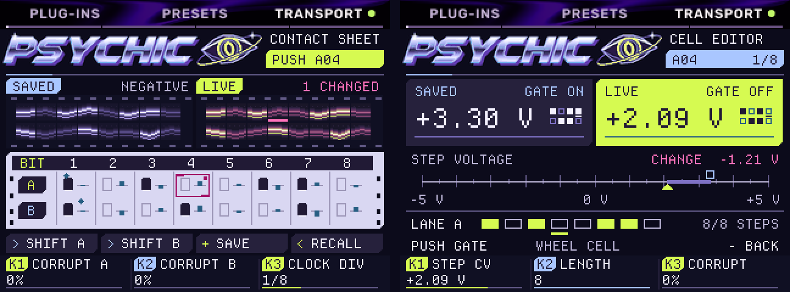

# Psychic

A generative analog-style synthesizer as a CLAP plug-in, built for the Akai MPC Sample running Melodee (64-bit ARM
Linux, Cortex-A55). Hosts list it as **hdslave Psychic** (id `com.hdslave.psychic`). It follows the front panel and
normalled signal flow of the Moog Labyrinth, without the patch bay: a sine VCO and a triangle Mod VCO with
through-zero FM, ring mod and noise into an overdriving mixer, a wavefolder and a 2-pole state-variable filter (in
parallel or one into the other), two VCAs and a Blend, played by two corruptible 8-bit sequencers. Four patch-bay
moves come as controls of their own: a second clock, the Mod VCO into Fold and into Cutoff, and the VCAs held open.

Its sequencers are clocked by the host: steps fall on the host's beat grid while it plays, stop when it stops, and
start again from the song's place when it starts or jumps.

## Contact Sheet on the MPC Sample

In hdslaveOS, open Psychic in Melodee's Edit or Stage plug-in page. Each frame in the two film strips is a step.
The upper row is sequencer A, the lower row B. An open gate lights up the ribbon, and the height of its centre shows
the step voltage. Select **Save** to print the pattern on the left. Pink underlines on the live print and magenta dots
on the punch card mark cells whose gate or voltage differs. **Recall** restores the saved sequencer settings.
During playback, the ring around the eye spins once every four quarter notes at the project tempo.



| View | Wheel and push | K1 | K2 | K3 |
|---|---|---|---|---|
| Contact Sheet | Turn to a cell and push to open it, or select Shift A, Shift B, Save or Recall and push | Corrupt A | Corrupt B | Clock Div |
| Cell editor | Turn through the 16 cells. Push to toggle the gate. Minus returns to the sheet | Step voltage | Lane length | Lane corruption |
| Parameter pages | Turn to a parameter. Push to edit its value or fire a button | Selected parameter | Next parameter | Following parameter |

On the card, a filled punch is an open gate. The small bar beside it shows voltage above or below zero. Diamonds
mark the write heads, and bars below the cells mark the play heads. Cells beyond the lane length are dimmed.
**Plus** opens the parameter pages. Use **Minus/Plus** to move between groups and hold **Shift** for the control guide.

The page uses the hdslaveOS screen extension for Melodee by Kerem Kiliç (Ellic Studio).
The bitmap typeface is Departure Mono. [Font license](licenses/OFL-departure-mono.txt)

## Signal flow

```
SEQ 1 CV ──► VCO pitch (VCO Seq 1 Amt; QTZ: in tune) and Fold (VCW Seq 1 Amt)
SEQ 2 CV ──► Mod VCO pitch (Mod VCO Seq 2 Amt; QTZ: in tune) and Cutoff (VCF Seq 2 Amt)
SEQ 1 and SEQ 2 triggers ──► EG Trig Mix ──► EG1 and EG2 (the mix sets their peak)
EG1 ──► VCO pitch, Mod VCO pitch, Fold, Cutoff (each by its own ± amount)

Mod VCO (triangle) ──through-zero FM──► VCO (sine)
VCO + VCO × Mod VCO (ring) + Mod VCO + noise (Noise Tone) ──► mixer (overdrives past 12 o'clock)
  ──► VCW (wavefolder: Fold, Bias) and VCF (2-pole state variable, LP … BP)
      Order: Parallel (both from the mixer), VCW > VCF, or VCF > VCW
  ──► VCW VCA and VCF VCA (both EG2) ──► Blend ──► Volume ──► out (stereo)
```

## The sequencers

Each sequencer has 8 **bits**. A bit is on or off, and each holds a CV between −5 and +5 V.

- On each clock the **play head** moves on a bit (round its **Length**). If that bit is on, it sends a trigger and the
  sequencer's CV output takes the bit's CV, holding it until the next on bit.
- The CV output passes through **CV Range** (0 to ±5 octaves at 1 V/octave) and the **quantizer** (16 modes, one for
  both sequencers), then to its destinations.
- The **write head** moves with the play head, **Write Head** bits ahead of it (0 by default: the bit just played).
  **Bit Flip** turns over the bit under it. A bit turned on gets a new random CV.
- **Corrupt** rolls dice at the write head on every clock. From fully left to 12 o'clock, the chance grows that an on
  bit gets a new CV: the notes change, the rhythm stays. Past 12 o'clock, the chance also grows that the bit flips:
  the rhythm changes too. Fully left, the sequence loops as it is.
- **Bit Shift** rotates the sequence one bit to the right, and the last bit comes round to bit 1.
- **Chain Seq** makes one ring of SEQ 1's bits followed by SEQ 2's (up to 16). Both play heads run round it, together
  when chaining starts. Then **Bit Shift 1** rotates the whole ring, and **Bit Shift 2** moves SEQ 2's play head on a
  bit, opening a gap between the two heads. The gap holds through jumps and loops; turn Chain Seq off and on, or
  play from a stop, to bring the heads back together.
- **EG Trig Mix** sets how hard each sequencer's triggers hit the envelopes. Fully left, SEQ 1's triggers fire at full
  and SEQ 2's do nothing. Fully right, the reverse. In the middle, each fires at half, and both together at full, so
  where the two patterns meet you get an accent.
- **Bits 1** and **Bits 2** show the patterns as the panel's LEDs would, step 1 first (`X.XX.XX.`). Turn them, or
  type a pattern, to set one. **Seq 1 CV 1–8** and **Seq 2 CV 1–8** show the bits' CVs and let you set them. When Bit
  Flip, Bit Shift, Corrupt or Recall changes these, the host is told, so a project saves the sequences as they are.
- **Save** keeps the sequences (bits, CVs, Lengths, Write Heads, Chain Seq, Quantize) in a buffer, and **Recall** puts
  them back. Corrupt a pattern into something new, and Recall the one you saved if you lose it. The buffer is saved
  with the project.

The dice are a fixed series from when the plug-in is loaded. A project loaded and played the same way plays the same
way, every time.

## Controls

The public CLAP parameter names and their panel equivalents are listed below.

| Psychic | Labyrinth panel | Range |
|---|---|---|
| VCO Freq | VCO FREQUENCY | 20 Hz – 5.12 kHz (8 octaves), a sine |
| VCO EG1 Amt | VCO EG1 AMT | ±8 octaves at a full trigger |
| VCO Seq 1 Amt | VCO SEQ1 AMT (QTZ at the top) | 0 – 100 %, then **QTZ**: SEQ 1 at 1 V/octave, in tune. Below QTZ the CV is scaled, so the intervals come out of tune |
| Mod VCO Freq | MOD VCO FREQUENCY | 0.16 Hz (a 6 s LFO) – 1.31 kHz, a triangle |
| Mod VCO EG1 Amt | MOD VCO EG1 AMT | ±8 octaves |
| Mod VCO Seq 2 Amt | MOD VCO SEQ2 AMT | as VCO Seq 1 Amt, for SEQ 2 |
| FM Amt | MOD VCO FM AMT | 0 – 100 %: through-zero linear FM of the VCO by the Mod VCO, index 4 at full. The VCO's centre stays put |
| VCO Level, Mod VCO Level, Ring Mod Level, Noise Level | VCO LVL, MOD VCO LVL, RING MOD LVL, NOISE LVL | 0 – 100 %: unity at 12 o'clock, overdrive past it |
| Noise Tone | NOISE TONE | low (a low pass) … white at 12 o'clock … high (a high pass) |
| Fold | VCW FOLD | 0 % clean … about four folds each way at full |
| Bias | VCW BIAS | ±100 %: a DC offset before the folder, which shifts even against odd harmonics |
| VCW EG1 Amt | VCW EG1/CV AMT | ±100 %: EG1 moves Fold by up to its whole turn |
| VCW Seq 1 Amt | VCW SEQ1 AMT | 0 – 100 %: SEQ 1's ±5 V moves Fold by up to a whole turn each way |
| Cutoff | VCF CUTOFF | 20 Hz – 20.5 kHz |
| Resonance | RESONANCE | none to a Q of 10: it rings but stays below self-oscillation, and LP keeps its low end |
| Filter Mode | the filter's mode control | LP … BP, mixed in between |
| VCF EG1 Amt | VCF EG1/CV AMT | ±8 octaves |
| VCF Seq 2 Amt | VCF SEQ2 AMT | 0 – 100 %: SEQ 2's CV at up to 1 V/octave |
| Order | ORDER | Parallel / VCW > VCF / VCF > VCW |
| Blend | BLEND | VCW (its VCA) … VCF (its VCA) |
| Volume | VOLUME | 0 – 100 % |
| EG1 Decay, EG2 Decay | EG1 DECAY, EG2 (VCA) DECAY | 10 ms – 8 s (time to −60 dB); decay-only, about 1 ms to rise |
| EG Trig Mix | EG TRIG MIX | Seq 1 … 50 / 50 … Seq 2 |
| Clock Div | TEMPO (replaced) | 1/2 … 1/64 of the host's beat, with triplets |
| Run | RUN/STOP | Stop / Run |
| Quantize | the quantizer's 16 modes (button combinations on the panel) | Unquantized, Chromatic, Major, Pentatonic, Melodic Minor, Harmonic Minor, Diminished 6th, Whole Tone, Hirajoshi, 7 Sus 4, Major 7th, Major 13th, Minor 7th, Minor 11th, Hang Drum, Quads (Minor 3rds) |
| Trigger | TRIGGER | fires EG1 and EG2 at full |
| Advance | ADVANCE | moves both play heads on a bit without playing (only while the sequences are not running) |
| Reset | RESET | both play heads back to bit 1, which the next clock plays. The write heads keep their distance |
| Corrupt 1, Corrupt 2 | CORRUPT | 0 – 100 % (see above) |
| CV Range 1, CV Range 2 | SEQ CV RANGE | 0 – ±5 octaves |
| Length 1, Length 2 | LENGTH | 1 – 8 |
| Bit Flip 1, Bit Flip 2 | BIT FLIP | turns over the bit under the write head |
| Bit Shift 1, Bit Shift 2 | BIT SHIFT | rotates the sequence one bit right |
| Bits 1, Bits 2 | the bit LEDs | the pattern, step 1 first |
| Chain Seq | CHAIN SEQ | Off / On |
| Write Head 1, Write Head 2 | the write-head offset (button combination) | +0 – +7 bits after the play head |
| Swing | — | 50 – 75 %: the second step of each pair comes late, as an MPC's swing does |
| Save, Recall | BUFFER (save), recall on Reset | the buffer |
| Clock 2 | patch: CLOCK 2 input | Clock 1 (normalled), or a grid of its own (1/2 … 1/64): polyrhythms |
| Mod VCO > Fold | patch: M VCO out to VCW FOLD | ±100 %: the Mod VCO moves Fold by up to a whole turn |
| Mod VCO > Cutoff | patch: M VCO out to CUTOFF | ±100 %: up to ±5 octaves |
| Drone | patch: a voltage into both VCA CV inputs | Off / On: the VCAs held open |
| Seq 1 CV 1–8, Seq 2 CV 1–8 | the bits' CVs | ±5.00 V |

### MIDI notes

As on the panel, a note transposes the quantized sequences. Each note moves the scale's root by its distance from
middle C (60), and the transposition holds until the next note. Unquantized, notes do not transpose. While the
sequences are not running (the host stopped, or Run off), a note also fires both envelopes, at the note's velocity,
so the stopped Psychic plays like a mono synth. A note on Play's own frame counts as running (it transposes); one on
Stop's frame plays.

## Presets

Seven factory presets, inside the plug-in: Melodee lists them on the plug-in's PRESETS page (any host with CLAP preset
discovery does). A preset sets every control and both sequences. Default puts everything back.

| Preset | What it is |
|---|---|
| Default | The panel as it opens: two patterns in Major, a little fold and FM, both paths blended |
| Psychic Bells | FM bells in Pentatonic at 1/16, SEQ 1 corrupting its notes slowly, the folder mostly heard |
| Fold Bass | A low, folded bass in Minor 7th: VCW > VCF, resonant, SEQ 1 alone at 1/16 over 7 steps |
| Chain Melody | Chain Seq: one 11-step ring, both heads on it, through both paths |
| Polyrhythm | SEQ 1 (5 steps at 1/16) against SEQ 2 on Clock 2 (3 steps at 1/8T), ring mod in Minor 11th |
| Corrupt Drone | Drone, a slow Mod VCO sweeping Fold and Cutoff, both sequencers corrupting at 1/4 |
| Noise Perc | Noise through a resonant band pass whose pitch SEQ 2 plays, accents where both sequences meet |

The test build renders each preset as `build/demo-<key>.wav` to listen to.

## Clocking from the host

- A clock lands on every multiple of Clock Div, counted from the song's top, while the host plays. With Swing, every
  second clock is late. Play from the top plays bit 1 on its first frame, and each later step lands on its frame.
  Clock Div (or Clock 2) changed on a step's frame still plays that step, then goes on on the new grid.
- A Play places each play head by the song's place: the clock's number from the top, round its ring. So Play from the
  top always starts both sequences at bit 1, and polymeters line up the same way each time. A pre-roll before the
  top plays the ring's last bits, and bit 1 lands on the top.
- Stop stops the sequences, and sounds ring out. Play again starts from where the song is.
- A jump, or a loop going round, lines the sequences up with the song's place again, each play head keeping its
  distance from it: what Reset, Advance and Bit Shift 2 did holds through the loop.
- Melodee tells a plug-in where the song is only at its own blocks: a loop whose end falls inside a block is told
  at the next one. The loop's first step has already played on its frame by then (the loop's end is its start), so
  it is not played again; the sequences just line up with it. If that step was silent where the count had run on to
  (a ring that does not divide the loop) and the loop's first step is on, it sounds at the start of the next block.
- A host whose count drifts from Psychic's (its tempo moving inside a block) is followed without a jump: every step
  plays once. Tempos past 1000 BPM are taken as 1000.
- Settings the host sends on Play's own frame are in place for Play. Buttons sent then (a Reset, say) act after Play
  has placed the heads, so they stick.
- Run off: the host plays but the sequences hold where they are and stay silent. Advance and Trigger work as on the
  panel, and notes play. Run on again goes on from where they held, at the next clock.
- In Melodee, keep the plug-in's **TRANSPORT** on (the default): with it off the plug-in never hears Play.

## Where values were inferred

The Labyrinth's manual gives the routing and several ranges: VCO about 20 Hz to 5 kHz, Mod VCO up to about 1.3 kHz,
cutoff 20 Hz to 20 kHz, EG decays 10 ms to over 5 s, ±5 V sequencer CVs, the 16 quantizer modes. It does not give
these, so they are chosen to fit what it does document:

- Corrupt's chances: a new CV with a chance of up to 25 % a step at 12 o'clock and 50 % at full; a flip with a chance
  from 0 at 12 o'clock to 50 % at full.
- The sequencer's CV holds from one on bit to the next. Off bits leave it where it is.
- MIDI notes transpose from middle C. A note's velocity sets its envelopes' peak.
- Depths: EG1 ±8 octaves on pitch and cutoff (its 8 V at 1 V/octave), through-zero FM index 4, about four folds
  at full Fold, a Q of 10 at full Resonance, Mod VCO 0.16 Hz at its lowest, EG decays to 8 s.
- The scales behind the names Hirajoshi (1 2 b3 5 b6) and Hang Drum (1 2 b3 5 b6 b7). Major 13th and Minor 11th
  fold their 9th into the octave.
- The mixer's overdrive, the folder's curve (a sine, scaled back below a quarter turn so it is clean at 0), the filter's
  LP … BP mix, Blend's linear crossfade.

Left out on purpose: the rest of the patch bay (VCO 1V/OCT inputs, Mod VCO sync, external audio into the VCW and
VCF, EG2 TRIG, the utility mixer, the BIT FLIP and RESET jacks), the global settings, the Tempo knob and MIDI clock
division (the clock is the host's), and the panel's button combinations (each function has its own control here).

## Cost

One voice, run at twice the host's rate (so FM, folding and the filter stay clean) and filtered back down with a
half-band FIR. Instructions a 128-frame block takes, from `tools/bench.sh` (callgrind):

| Case | Instructions | Share of one A55 core at 1 instruction a cycle |
|---|---|---|
| Everything busy (Drone, FM, ring, noise, folding moved by EG1 and the Mod VCO, resonance, both sequencers corrupting on their own clocks) | about 82,000 | 1.7 % |
| The default patch at 1/16 with a little Corrupt | about 81,000 | 1.7 % |
| The same with two knobs turning all the time (Cutoff and Fold every 16 frames) | about 92,000 | 1.9 % |
| Stopped | under 800 | 0.02 % |

While both envelopes are idle and the VCAs closed, the oscillators and filter are skipped. A knob's change is worked
out every 8 frames; the envelopes' and Noise Tone's rates (which need `exp` and `pow`) only when those knobs move. The real share on the MPC
depends on how many instructions the A55 retires a cycle on this code. Melodee's plug-in load figure measures it.

## Build and test

Needs Docker with a Linux arm64 context (Melodee's `colima-melodee` and its `melodee-builder` image by default).

```sh
./build.sh          # build/Psychic.clap, then the tests (tests/host.cpp), the sound's fingerprint and demo renders build/demo-*.wav
./build.sh bench    # build/bench
tools/bench.sh      # instruction counts for worst, typical, turning and stopped (Melodee's melodee-profiler image)
```

The tests load the plug-in through the CLAP API and check:

- screen painting, playhead positions, hardware bindings, cell edits, snapshot recall and expired button presses;

- the description, ports and every parameter's range, text and default (the patterns' `X.XX....`, QTZ, LP/BP, the
  two-way knobs);
- state save and load, the buffer travelling with it, and a state without one;
- the presets, as preset discovery lists them and preset-load loads them;
- step timing to the frame at 44.1, 48 and 96 kHz, two tempos and Swing; stop, restart, jumps, a loop wrapping
  inside a block, a host without a song position, a pre-roll, a tempo ramping from 120 to 240 BPM (each step once,
  in 128, 256 and 512-frame blocks) and absurd tempos;
- Clock Div changed on a step's frame (that step plays), and on Clock 2's step (Clock 2 untouched); a state loaded
  between two blocks with a step on the next one's first frame;
- what Reset and Bit Shift 2 did, kept through a two-bar loop; Run off and on; Lengths and Chain Seq changed while
  playing, the heads past the ring's end;
- Drone switched on, the same whatever the block size; notes and Reset on Play's and Stop's frames; notes in the MIDI
  dialect; flush with values and buttons, active and not;
- a state loaded while a block plays, in the block where the engine changes a value or Save is pressed (the loaded
  values and buffer stand, even a value equal to the one before the change);
- a two-bar loop as Melodee plays it, its end inside a block: every step once, on its frame; a ring of 5 in it;
- odd text: empty, `nan`, padded choice names, numbers in place of names, a unit's edge;
- the same output and the same values heard back whatever the block size (1, 37, 128, 4096 frames), with the dice
  rolling;
- the bits as hits, EG Trig Mix (each end, the middle, and both at once twice as loud), polymeter Lengths, Bit Shift,
  Bit Flip at the write head (and its new CV heard by the host), Chain Seq and its ring shift, Reset and Advance;
- Corrupt: fully left it loops at the same pitches, at 45 % it changes notes but not the rhythm, and at full it flips
  bits, the same each time;
- pitch: the VCO and Mod VCO to 0.2 %, seven quantizer modes, scaled Seq Amt, CV Range, and MIDI transposing (and not
  when Unquantized);
- Clock 2's triplets against Clock 1, with their meeting accents;
- routing: Order and Blend (each path the same to the bit where it should be), Fold clean at 0, Noise Tone and Drone;
- finite, bounded output at 60 random and extreme settings, buttons pressed.

`tests/fingerprint.cpp` then renders 53 fixed scenarios and hashes every output sample's bits, and the values the
plug-in tells the host it changed, against `tests/fingerprint.txt`. The scenarios: each preset, the bench's patches,
24 random patches with the buttons, MIDI and knobs moving, other block sizes and rates, stop and jumps, Corrupt
across its turn, chained moves and the buffer, Clock 2 with Swing, notes, each Order, and two-bar loops as Melodee
plays them. Work meant to keep the
sound, such as a speed-up, must leave every hash as it is. A change meant to change the sound updates them with
`make fingerprint-update` (run inside the build image). The hashes hold for Melodee's build image and these compiler
flags.

## Install

Copy `build/Psychic.clap` to `Melodee/Plugins/hdslave Psychic/hdslave Psychic.clap` on the card (or the staged
card's folder), then pick it on an empty track: Stage, Plugin, hdslave Psychic. It needs only libc and libm (glibc
2.35 or older).
