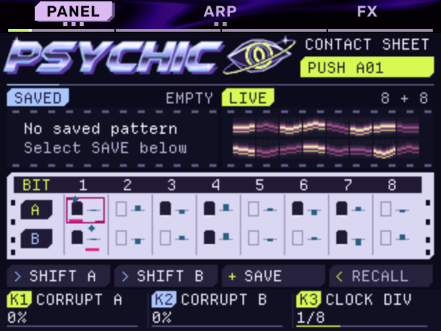
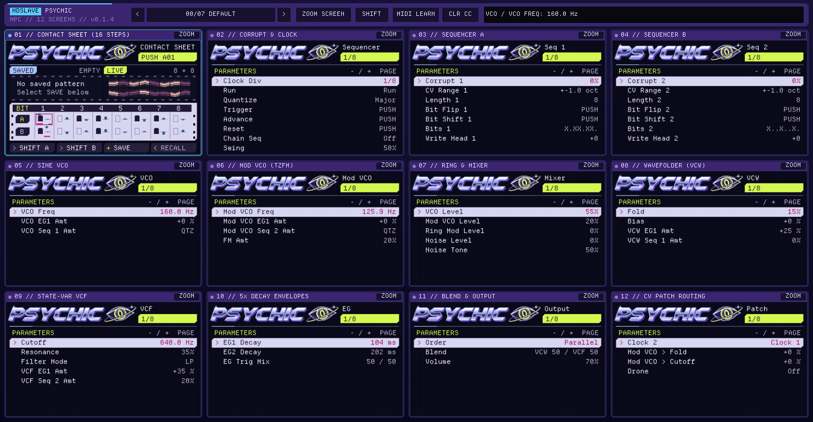

# hdslave Psychic

**A generative analog-style dual-sequencer synthesizer (Labyrinth panel & flow) as a CLAP plug-in for the Akai MPC Sample.**

<table>
  <tr>
    <th width="34%">MPC Sample</th>
    <th width="66%">macOS and Windows · CLAP</th>
  </tr>
  <tr>
    <td align="center"><a href="docs/psychic-screen.webp"></a></td>
    <td align="center"><a href="mac-clap/assets/desktop-preview.webp"></a></td>
  </tr>
</table>

> **Desktop CLAP version (macOS & Windows):** A separate desktop CLAP build with all MPC screens on one interactive panel lives in [**`mac-clap/`**](mac-clap/) (`cd mac-clap && ./install-macos.sh`). Releases in this repo stay MPC Sample-only for now while the desktop builds are being finalized.

Built for the Akai MPC Sample running [Melodee](https://github.com/keremimo/melodee-sample) / [hdslaveOS](https://github.com/hdslave/hdslaveOS) (64-bit ARM Linux, Cortex-A55). Hosts list it as **hdslave Psychic** (id `com.hdslave.psychic`). It follows the front panel and normalled signal flow of the Moog Labyrinth (without the patch bay): a sine VCO and triangle Mod VCO with through-zero FM, ring mod, and noise feeding an overdriving mixer, a wavefolder, and a 2-pole state-variable filter (parallel or series), two VCAs, and Blend — driven by two corruptible 8-bit sequencers that can chain into a 16-step ring. Four classic patch-bay moves are built right in: a second clock, Mod VCO into Fold and Cutoff, and VCA drone hold.

Its sequencers lock tightly to the host transport and beat grid. Under **hdslaveOS**, Psychic draws its animated **Contact Sheet** screen comparing saved and live steps side by side with direct per-cell gate and voltage editing.

Version 0.3.0. Not yet run on the MPC: it is checked in Melodee's build image and loads in hdslaveOS's CLAP host
(`clap_check`), but nobody has played it on the device yet. The 0.3.0 drum map and banks (below) have not been tried
on the device either.

## hdslave plug-in license

You may use these plug-ins to make, perform, record and sell music, including paid client work, without royalties or credit to hdslave. You may share complete, unchanged official releases for free with their notices intact. Selling the software, including it in a paid product or subscription, or distributing a modified version requires prior written permission from hdslave. Third-party components keep their own licenses. [Full plug-in license](LICENSE.txt).

## Contact Sheet on the MPC Sample

In hdslaveOS, open Psychic in Melodee's Edit or Stage plug-in page. Each frame in the two film strips is a step.
The upper row is sequencer A, the lower row B. An open gate lights up the ribbon, and the height of its centre shows
the step voltage. Select **Save** to print the pattern on the left. Pink underlines on the live print and magenta dots
on the punch card mark cells whose gate or voltage differs. **Recall** restores the saved sequencer settings.
During playback, the ring around the eye spins once every four quarter notes at the project tempo.

[](docs/contact-sheet.png)

| View | Wheel and push | K1 | K2 | K3 |
|---|---|---|---|---|
| Contact Sheet | Turn to a cell and push to open it, or select Shift A, Shift B, Save or Recall and push | Corrupt A | Corrupt B | Clock Div |
| Cell editor | Turn through the 16 cells. Push to toggle the gate. Minus returns to the sheet | Step voltage | Lane length | Lane corruption |
| Parameter pages | Turn to a parameter. Push to edit its value or fire a button | Selected parameter | Next parameter | Following parameter |

On the card, a filled punch is an open gate. The small bar beside it shows voltage above or below zero. Diamonds
mark the write heads, and bars below the cells mark the play heads. Cells beyond the lane length are dimmed.
**Plus** opens the parameter pages. Use **Minus/Plus** to move between groups and hold **Shift** for the control guide.

The custom screen uses `melodee.screen/1` on Melodee 0.7 and hdslaveOS based on it. Open Edit on the plug-in track or select PANEL on Stage. The SDK is by Kerem Kiliç (Ellic Studio).
The bitmap typeface is Departure Mono. [Font license](licenses/OFL-departure-mono.txt)

## Signal flow

```
SEQ 1 CV ──► VCO pitch (VCO Seq 1 Amt; QTZ: in tune) and Fold (VCW Seq 1 Amt)
SEQ 2 CV ──► Mod VCO pitch (Mod VCO Seq 2 Amt; QTZ: in tune) and Cutoff (VCF Seq 2 Amt)
SEQ 1 and SEQ 2 triggers ──► EG Trig Mix ──► EG1 and EG2 (the mix sets their peak)
EG1 ──► VCO pitch, Mod VCO pitch, Fold, Cutoff (each by its own ± amount)

Mod VCO (triangle) ──through-zero FM──► VCO (sine)
VCO + VCO × Mod VCO (ring) + Mod VCO + noise (Noise Tone) ──► mixer (overdrives past 12 o'clock)
  ──► VCW (wavefolder: Fold, Bias) and VCF (2-pole state variable, LP … BP)
      Order: Parallel (both from the mixer), VCW > VCF, or VCF > VCW
  ──► VCW VCA and VCF VCA (both EG2) ──► Blend ──► Volume ──► out (stereo)
```

## The sequencers

Each sequencer has 8 **bits**. A bit is on or off, and each holds a CV between −5 and +5 V.

- On each clock the **play head** moves on a bit (round its **Length**). If that bit is on, it sends a trigger and the
  sequencer's CV output takes the bit's CV, holding it until the next on bit.
- The CV output passes through **CV Range** (0 to ±5 octaves at 1 V/octave) and the **quantizer** (16 modes, one for
  both sequencers), then to its destinations.
- The **write head** moves with the play head, **Write Head** bits ahead of it (0 by default: the bit just played).
  **Bit Flip** turns over the bit under it. A bit turned on gets a new random CV.
- **Corrupt** rolls dice at the write head on every clock. From fully left to 12 o'clock, the chance grows that an on
  bit gets a new CV: the notes change, the rhythm stays. Past 12 o'clock, the chance also grows that the bit flips:
  the rhythm changes too. Fully left, the sequence loops as it is.
- **Bit Shift** rotates the sequence one bit to the right, and the last bit comes round to bit 1.
- **Chain Seq** makes one ring of SEQ 1's bits followed by SEQ 2's (up to 16). Both play heads run round it, together
  when chaining starts. Then **Bit Shift 1** rotates the whole ring, and **Bit Shift 2** moves SEQ 2's play head on a
  bit, opening a gap between the two heads. The gap holds through jumps and loops; turn Chain Seq off and on, or
  play from a stop, to bring the heads back together.
- **EG Trig Mix** sets how hard each sequencer's triggers hit the envelopes. Fully left, SEQ 1's triggers fire at full
  and SEQ 2's do nothing. Fully right, the reverse. In the middle, each fires at half, and both together at full, so
  where the two patterns meet you get an accent. A softer trigger never cuts a louder one: while a louder hit is
  still rising (a Trigger on a step's frame, two notes in one block), the softer one leaves its peak, and over a
  tail still falling it does not cut the tail.
- **Bits 1** and **Bits 2** show the patterns as the panel's LEDs would, step 1 first (`X.XX.XX.`). Turn them, or
  type a pattern, to set one. **Seq 1 CV 1–8** and **Seq 2 CV 1–8** show the bits' CVs and let you set them. When Bit
  Flip, Bit Shift, Corrupt or Recall changes these, the host is told, so a project saves the sequences as they are.
- **Save** keeps the sequences (bits, CVs, Lengths, Write Heads, Chain Seq, Quantize) in a buffer, and **Recall** puts
  them back. Corrupt a pattern into something new, and Recall the one you saved if you lose it. The buffer is saved
  with the project.

The dice are a fixed series from when the plug-in is loaded. A project loaded and played the same way plays the same
way, every time.

## Controls

The public CLAP parameter names and their panel equivalents are listed below.

| Psychic | Labyrinth panel | Range |
|---|---|---|
| VCO Freq | VCO FREQUENCY | 20 Hz – 5.12 kHz (8 octaves), a sine |
| VCO EG1 Amt | VCO EG1 AMT | ±8 octaves at a full trigger |
| VCO Seq 1 Amt | VCO SEQ1 AMT (QTZ at the top) | 0 – 100 %, then **QTZ**: SEQ 1 at 1 V/octave, in tune. Below QTZ the CV is scaled, so the intervals come out of tune |
| Mod VCO Freq | MOD VCO FREQUENCY | 0.16 Hz (a 6 s LFO) – 1.31 kHz, a triangle |
| Mod VCO EG1 Amt | MOD VCO EG1 AMT | ±8 octaves |
| Mod VCO Seq 2 Amt | MOD VCO SEQ2 AMT | as VCO Seq 1 Amt, for SEQ 2 |
| FM Amt | MOD VCO FM AMT | 0 – 100 %: through-zero linear FM of the VCO by the Mod VCO, index 4 at full. The VCO's centre stays put |
| VCO Level, Mod VCO Level, Ring Mod Level, Noise Level | VCO LVL, MOD VCO LVL, RING MOD LVL, NOISE LVL | 0 – 100 %: unity at 12 o'clock, overdrive past it |
| Noise Tone | NOISE TONE | low (a low pass) … white at 12 o'clock … high (a high pass) |
| Fold | VCW FOLD | 0 % clean … about four folds each way at full |
| Bias | VCW BIAS | ±100 %: a DC offset before the folder, which shifts even against odd harmonics |
| VCW EG1 Amt | VCW EG1/CV AMT | ±100 %: EG1 moves Fold by up to its whole turn |
| VCW Seq 1 Amt | VCW SEQ1 AMT | 0 – 100 %: SEQ 1's ±5 V moves Fold by up to a whole turn each way |
| Cutoff | VCF CUTOFF | 20 Hz – 20.5 kHz |
| Resonance | RESONANCE | none to a Q of 10: it rings but stays below self-oscillation, and LP keeps its low end |
| Filter Mode | the filter's mode control | LP … BP, mixed in between |
| VCF EG1 Amt | VCF EG1/CV AMT | ±8 octaves |
| VCF Seq 2 Amt | VCF SEQ2 AMT | 0 – 100 %: SEQ 2's CV at up to 1 V/octave |
| Order | ORDER | Parallel / VCW > VCF / VCF > VCW |
| Blend | BLEND | VCW (its VCA) … VCF (its VCA) |
| Volume | VOLUME | 0 – 100 % |
| EG1 Decay, EG2 Decay | EG1 DECAY, EG2 (VCA) DECAY | 10 ms – 8 s (time to −60 dB); decay-only, about 1 ms to rise |
| EG Trig Mix | EG TRIG MIX | Seq 1 … 50 / 50 … Seq 2 |
| Clock Div | TEMPO (replaced) | 1/2 … 1/64 of the host's beat, with triplets |
| Run | RUN/STOP | Stop / Run. Run: pads 1–16 play the steps; Stop: the pads play notes (see MIDI notes and pads) |
| Quantize | the quantizer's 16 modes (button combinations on the panel) | Unquantized, Chromatic, Major, Pentatonic, Melodic Minor, Harmonic Minor, Diminished 6th, Whole Tone, Hirajoshi, 7 Sus 4, Major 7th, Major 13th, Minor 7th, Minor 11th, Minor 6-Note, Quads (Minor 3rds) |
| Trigger | TRIGGER | fires EG1 and EG2 at full |
| Advance | ADVANCE | moves both play heads on a bit without playing (only while the sequences are not running) |
| Reset | RESET | both play heads back to bit 1, which the next clock plays. The write heads keep their distance |
| Corrupt 1, Corrupt 2 | CORRUPT | 0 – 100 % (see above) |
| CV Range 1, CV Range 2 | SEQ CV RANGE | 0 – ±5 octaves |
| Length 1, Length 2 | LENGTH | 1 – 8 |
| Bit Flip 1, Bit Flip 2 | BIT FLIP | turns over the bit under the write head |
| Bit Shift 1, Bit Shift 2 | BIT SHIFT | rotates the sequence one bit right |
| Bits 1, Bits 2 | the bit LEDs | the pattern, step 1 first |
| Chain Seq | CHAIN SEQ | Off / On |
| Write Head 1, Write Head 2 | the write-head offset (button combination) | +0 – +7 bits after the play head |
| Swing | — | 50 – 75 %: the second step of each pair comes late, as an MPC's swing does |
| Save, Recall | BUFFER (save), recall on Reset | the buffer |
| Clock 2 | patch: CLOCK 2 input | Clock 1 (normalled), or a grid of its own (1/2 … 1/64): polyrhythms |
| Mod VCO > Fold | patch: M VCO out to VCW FOLD | ±100 %: the Mod VCO moves Fold by up to a whole turn |
| Mod VCO > Cutoff | patch: M VCO out to CUTOFF | ±100 %: up to ±5 octaves |
| Drone | patch: a voltage into both VCA CV inputs | Off / On: the VCAs held open (hdslaveOS's silence shuts them until a strike, Drone turned on again, or a preset or state loaded) |
| Seq 1 CV 1–8, Seq 2 CV 1–8 | the bits' CVs | ±5.00 V |

### MIDI notes and pads

- **The pads are a drum map.** The plug-in carries a drum map that hdslaveOS (and Melodee) read from it. A Psychic
  track plays its 16 pads as drums: pads A01–A16 always send notes 36–51, whatever the track's octave, key or scale.
  The Keys page names them **S1 Bit 1**–**S1 Bit 8** (notes 36–43) and **S2 Bit 1**–**S2 Bit 8** (notes 44–51).
- **− / + move the bank, not the octave.** Bank B sends 52–67, C 68–83, D 84–99 (and below A the same way down).
  With Run on, every bank plays the same 16 step pads, an octave apart per bank: bank B an octave up, C two, D three.
  Keys past D stay at three octaves up, and keys below A go at most two octaves down. Psychic reads a key this way
  with Run on: its pad is (key − 36) mod 16 and its bank ⌊(key − 36) / 16⌋.
- **Run on (the sequencer on): every pad plays its step**, whether the host plays or not, in every bank. Pads 1–8 are
  SEQ 1's bits 1–8 and pads 9–16 SEQ 2's bits 1–8. With Chain Seq on, that is the ring's 16 bits in order.
- A pad plays its bit as the sequencer would: that sequencer's CV output takes the bit's CV, through CV Range, the
  quantizer and the current transposition, and both envelopes fire at the pad's velocity. It does this whether the bit
  is on or off, and past the Length too. Chained, both CV outputs take it, as when both play heads are on that bit.
  A pad of another bank adds its octaves to that CV output (in every Quantize mode, through the same Seq Amt as the
  CV), so it is never another step and never silent.
- A pad moves nothing else: not the play or write heads, the bits, their CVs or the transposition, and the host is
  told of nothing. The bit's CV, and its bank's octave, hold until that sequencer's next on bit plays.
- Two pads in one block (Melodee sends them on one frame): for each sequencer the louder pad's CV and bank win (on a
  tie, the later one), and the envelopes take the louder peak. A pad of each sequence gives each its own CV, as a step
  with both bits on does. A pad on Play's frame sounds; if the step Play lands on is on, its CV replaces the pad's at
  once.
- **Run off (the sequencer off): every key plays its own note, exactly as in 0.2.6.** There are no banks. As on the
  panel, the note transposes the quantized sequences by its distance from middle C (60), and the transposition holds
  until the next note. It also fires both envelopes at its velocity, so Psychic plays like a mono synth. Bank B's pad 1
  (key 52) is 16 semitones above pad A01 (36), as an outside keyboard or a recorded note plays it. This holds
  Unquantized too: there the note's distance from middle C is added to the CV as it is, so pads 1, 2 and 13 (notes
  36, 37 and 48) play a semitone and an octave apart, with VCO Seq 1 Amt at QTZ.
- Switching Run on keeps the last Run-off note's transposition for the quantized modes, and for when Run goes off
  again. Unquantized ignores it while Run is on, as on the panel.
- What 0.3.0 replaced: before it, with Run on, the notes outside 36–51 transposed the sequences (and fired the
  envelopes while stopped). Now they are step pads of the other banks, so with Run on only a note played with Run off
  transposes. Run off is unchanged.

## Presets

Seven factory presets, inside the plug-in: Melodee lists them on the plug-in's PRESETS page (any host with CLAP preset
discovery does). A preset sets every control and both sequences. Default puts everything back.

| Preset | What it is |
|---|---|
| Default | The panel as it opens: two patterns in Major, a little fold and FM, both paths blended |
| Psychic Bells | FM bells in Pentatonic at 1/16, SEQ 1 corrupting its notes slowly, the folder mostly heard |
| Fold Bass | A low, folded bass in Minor 7th: VCW > VCF, resonant, SEQ 1 alone at 1/16 over 7 steps |
| Chain Melody | Chain Seq: one 11-step ring, both heads on it, through both paths |
| Polyrhythm | SEQ 1 (5 steps at 1/16) against SEQ 2 on Clock 2 (3 steps at 1/8T), ring mod in Minor 11th |
| Corrupt Drone | Drone, a slow Mod VCO sweeping Fold and Cutoff, both sequencers corrupting at 1/4 |
| Noise Perc | Noise through a resonant band pass whose pitch SEQ 2 plays, accents where both sequences meet |

The test build renders each preset as `build/demo-<key>.wav` to listen to.

## Clocking from the host

- A clock lands on every multiple of Clock Div, counted from the song's top, while the host plays. With Swing, every
  second clock is late. Play from the top plays bit 1 on its first frame, and each later step lands on its frame.
  Clock Div (or Clock 2) changed on a step's frame still plays that step, then goes on on the new grid.
- A Play places each play head by the song's place: the clock's number from the top, round its ring. So Play from the
  top always starts both sequences at bit 1, and polymeters line up the same way each time. A pre-roll before the
  top plays the ring's last bits, and bit 1 lands on the top.
- Stop stops the sequences, and sounds ring out. Play again starts from where the song is.
- A jump, or a loop going round, lines the sequences up with the song's place again, each play head keeping its
  distance from it: what Reset, Advance and Bit Shift 2 did holds through the loop.
- Melodee tells a plug-in where the song is only at its own blocks: a loop whose end falls inside a block is told
  at the next one. The loop's first step has already played on its frame by then (the loop's end is its start), so
  it is not played again; the sequences just line up with it. If a sequence's bit was off where the count had run on
  to (a ring that does not divide the loop) and is on at the loop's first step, that step sounds at the start of the
  next block, at its full level with every sequence on there, as loud as on the first pass.
- A host whose count drifts from Psychic's (its tempo moving inside a block) is followed without a jump: every step
  plays once. Tempos past 1000 BPM are taken as 1000.
- Settings the host sends on Play's own frame are in place for Play. Buttons sent then (a Reset, say) act after Play
  has placed the heads, so they stick.
- Run off: the host plays but the sequences hold where they are and stay silent. Advance and Trigger work as on the
  panel, and notes play. Run on again goes on from where they held, at the next clock.
- In Melodee, keep the plug-in's **TRANSPORT** on (the default): with it off the plug-in never hears Play.

## Where values were inferred

The Labyrinth's manual gives the routing and several ranges: VCO about 20 Hz to 5 kHz, Mod VCO up to about 1.3 kHz,
cutoff 20 Hz to 20 kHz, EG decays 10 ms to over 5 s, ±5 V sequencer CVs, the 16 quantizer modes. It does not give
these, so they are chosen to fit what it does document:

- Corrupt's chances: a new CV with a chance of up to 25 % a step at 12 o'clock and 50 % at full; a flip with a chance
  from 0 at 12 o'clock to 50 % at full.
- The sequencer's CV holds from one on bit to the next. Off bits leave it where it is.
- MIDI notes (with Run off) transpose from middle C. A note's velocity sets its envelopes' peak.
- With Run off, notes transpose Unquantized too, which the panel's keyboard input does not: with the sequencer off the
  pads always play notes, whatever the quantizer.
- The step pads, which the panel does not have: notes 36–51, hdslaveOS's pads A01–A16 (the drum map holds them
  there), with − / +'s banks an octave apart. A pad fires the envelopes at its own velocity, not through EG Trig Mix,
  so SEQ 2's bits sound even with the mix at Seq 1. Chained, a pad's bit goes to both CV outputs.
- Depths: EG1 ±8 octaves on pitch and cutoff (its 8 V at 1 V/octave), through-zero FM index 4, about four folds
  at full Fold, a Q of 10 at full Resonance, Mod VCO 0.16 Hz at its lowest, EG decays to 8 s.
- The scales behind the names Hirajoshi (1 2 b3 5 b6) and Minor 6-Note (1 2 b3 5 b6 b7). Major 13th and Minor 11th
  fold their 9th into the octave.
- The mixer's overdrive, the folder's curve (a sine, scaled back below a quarter turn so it is clean at 0), the filter's
  LP … BP mix, Blend's linear crossfade.

Left out on purpose: the rest of the patch bay (VCO 1V/OCT inputs, Mod VCO sync, external audio into the VCW and
VCF, EG2 TRIG, the utility mixer, the BIT FLIP and RESET jacks), the global settings, the Tempo knob and MIDI clock
division (the clock is the host's), and the panel's button combinations (each function has its own control here).

## Cost

One voice, run at twice the host's rate (so FM, folding and the filter stay clean) and filtered back down with a
half-band FIR. Instructions a 128-frame block takes, from `tools/bench.sh` (callgrind):

| Case | Instructions | Share of one A55 core at 1 instruction a cycle |
|---|---|---|
| Everything busy (Drone, FM, ring, noise, folding moved by EG1 and the Mod VCO, resonance, both sequencers corrupting on their own clocks) | about 86,000 | 1.8 % |
| The default patch at 1/16 with a little Corrupt | about 84,000 | 1.8 % |
| The same with two knobs turning all the time (Cutoff and Fold every 16 frames) | about 96,000 | 2.0 % |
| Stopped | under 800 | 0.02 % |

While both envelopes are idle and the VCAs closed, the oscillators and filter are skipped. A knob's change is worked
out every 8 frames; the envelopes' and Noise Tone's rates (which need `exp` and `pow`) only when those knobs move. The real share on the MPC
depends on how many instructions the A55 retires a cycle on this code. Melodee's plug-in load figure measures it.

## Build and test

Needs Docker with a Linux arm64 context (Melodee's `colima-melodee` and its `melodee-builder` image by default).

```sh
./build.sh          # build/Psychic.clap, then the tests (tests/host.cpp), the sound's fingerprint and demo renders build/demo-*.wav
./build.sh bench    # build/bench
tools/bench.sh      # instruction counts for worst, typical, turning and stopped (Melodee's melodee-profiler image)
```

The tests load the plug-in through the CLAP API and check:

- screen painting, playhead positions, hardware bindings, cell edits, snapshot recall and expired button presses;

- the description, ports and every parameter's range, text and default (the patterns' `X.XX....`, QTZ, LP/BP, the
  two-way knobs);
- state save and load, the buffer travelling with it, and a state without one;
- the presets, as preset discovery lists them and preset-load loads them;
- step timing to the frame at 44.1, 48 and 96 kHz, two tempos and Swing; stop, restart, jumps, a loop wrapping
  inside a block, a host without a song position, a pre-roll, a tempo ramping from 120 to 240 BPM (each step once,
  in 128, 256 and 512-frame blocks) and absurd tempos;
- Clock Div changed on a step's frame (that step plays), and on Clock 2's step (Clock 2 untouched); a state loaded
  between two blocks with a step on the next one's first frame;
- what Reset and Bit Shift 2 did, kept through a two-bar loop; Run off and on; Lengths and Chain Seq changed while
  playing, the heads past the ring's end;
- Drone switched on, the same whatever the block size; notes and Reset on Play's and Stop's frames; notes in the MIDI
  dialect; flush with values and buttons, active and not;
- a state loaded while a block plays, in the block where the engine changes a value or Save is pressed (the loaded
  values and buffer stand, even a value equal to the one before the change);
- a two-bar loop as Melodee plays it, its end inside a block: every step once, on its frame; a ring of 5 in it; a
  downbeat one sequence sounds a block late, as loud as on the first pass and as a host telling of the wrap on its
  own frame plays it, apart and chained;
- odd text: empty, `nan`, padded choice names, numbers in place of names, a unit's edge;
- the same output and the same values heard back whatever the block size (1, 37, 128, 4096 frames), with the dice
  rolling;
- a softer trigger while a louder one is rising (two notes on one frame, or half a millisecond apart; a Trigger on a
  step's frame) leaving the louder peak, to the bit;
- the bits as hits, EG Trig Mix (each end, the middle, and both at once twice as loud), polymeter Lengths, Bit Shift,
  Bit Flip at the write head (and its new CV heard by the host), Chain Seq and its ring shift, Reset and Advance;
- Corrupt: fully left it loops at the same pitches, at 45 % it changes notes but not the rhythm, and at full it flips
  bits, the same each time;
- pitch: the VCO and Mod VCO to 0.2 %, seven quantizer modes, scaled Seq Amt, CV Range, and MIDI transposing (and not
  when Unquantized with Run on; with Run off, notes 36–51 too);
- with Run off and Unquantized, the keyboard (0.2.1): notes 36, 37 and 48 measured a semitone and an octave apart,
  stopped and playing; the same to the bit as Chromatic with the CV at 0; a CV between notes kept and transposed; the
  transposition scaled below QTZ and on SEQ 2's Mod VCO; with Run on, notes outside the pads still leaving the pitch and
  pads untransposed; Run switched over a held transposition (it goes and comes back), and on a note's frame (settings
  first); the same output at every block size;
- the drum map (0.3.0): in the binary, 16 levels named and on notes 36–51 in order; the banks with Run on: pad 1 of
  banks A–D, past D and below A measured (an octave a bank, at most three up and two down), pads of banks B, C and D an
  octave, two and three above bank A's, SEQ 2's bank pad only moving SEQ 2, chained to both, Unquantized, two pads on
  one frame, a bank pad's octave held to the next on bit and cleared by it; nothing heard back; the same output at every
  block size; with Run off, keys in every bank measured at key − 60 as in 0.2.6 (52 sixteen semitones above 36);
- the step pads: each of the 16, apart and chained, sounds to the bit as the sequencer playing its bit (stopped with
  the bit on and off, playing, on Play's frame for bit 1); pitches measured (quantized,
  transposed, Unquantized, chained, Run off); a pad's CV held until that sequencer's next on bit; the play heads
  unmoved (playing, and stopped with Advance); nothing heard back, Bits and CVs unchanged; two pads on one frame (the
  louder wins, on a tie the later; one of each sequence as a step with both bits on; one pad twice plays once); on,
  on, off; a note off and a CC 121 storm leaving what rings; a pad on Play's frame with its step on and off; Run
  switched on or off on
  the pad's frame; the same output at every block size;
- the host's silence: a choke (any key) and CC 120/123 at 0 stopping a held-open Drone and the longest EG2 tail
  within a block, the next step striking again, a note and a choke on one frame in the order sent, and a note off,
  CC 121 and CC 120 at 64 leaving what rings untouched; a silence while Drone is off (hdslaveOS's Stop sends CC 123)
  leaving Drone turned on later, a drone preset and a drone state sounding at once, to the bit as without it; a
  silenced Drone opening again when turned off and on, or when a drone state is loaded; and a drone preset or state
  loaded while hdslaveOS's idle gate lets it sleep (modelled block by block) sounding from the next block, to the bit
  as in an instance run every block (a load asks the host to run it);
- the reported latency (the decimator's group delay, measured by impulse through it at both inner phases) and
  tail (EG2 ringing to exact zero, endless with Drone), and the host told when Drone or EG2 Decay changes the
  tail — by event, by flush and by a preset load, and not by an unrelated knob or the same value again;
- Clock 2's triplets against Clock 1, with their meeting accents;
- routing: Order and Blend (each path the same to the bit where it should be), Fold clean at 0, Noise Tone and Drone;
- finite, bounded output at 60 random and extreme settings, buttons pressed.

`tests/fingerprint.cpp` then renders 63 fixed scenarios and hashes every output sample's bits, and the values the
plug-in tells the host it changed, against `tests/fingerprint.txt`. The scenarios: each preset, the bench's patches,
24 random patches with the buttons, MIDI and knobs moving, other block sizes and rates, stop and jumps, Corrupt
across its turn, chained moves and the buffer, Clock 2 with Swing, notes, step pads (playing, chained, stopped, and
with Run off as the keyboard), the drum map's banks (the same four ways), the keyboard Unquantized with Run switched
off and on, each Order, and two-bar loops as Melodee plays them. Work meant to keep the
sound, such as a speed-up, must leave every hash as it is. A change meant to change the sound updates them with
`make fingerprint-update` (run inside the build image). The hashes hold for Melodee's build image and these compiler
flags. Version 0.2.5 restores the 0.2.1 oscillator pitch rounding when Advance moves the stopped sequencers.
All 59 fingerprints match that reference, including the four random patches that diverged in 0.2.2.
The later panic, state-load and transport fixes keep their own host tests. Version 0.2.6 (the Drone after a silence, and a
load waking a sleeping instance) leaves all 59 fingerprints as they were. Version 0.3.0 (the drum map and its banks)
moves the 23 scenarios that send a key outside 36–51 while Run is on, and no other. They are 13 random patches and
random-0 at three block sizes (key 64), both notes scenarios, three step-pad scenarios (not the Run-off one) and both
Unquantized keyboard scenarios (keys during their Run-on stretch). A build that logs such keys finds exactly these 23.
The other 36 match 0.2.6. Four bank scenarios are new. The Run-off one (keys across every bank) renders the same on
0.2.6 to the bit.

## Install

Copy `build/Psychic.clap` to `Melodee/Plugins/hdslave/hdslave Psychic.clap` on the card (or the staged
card's folder), then pick it on an empty track: Stage, Plugin, hdslave, hdslave Psychic. It needs only libc and libm (glibc
2.35 or older).
